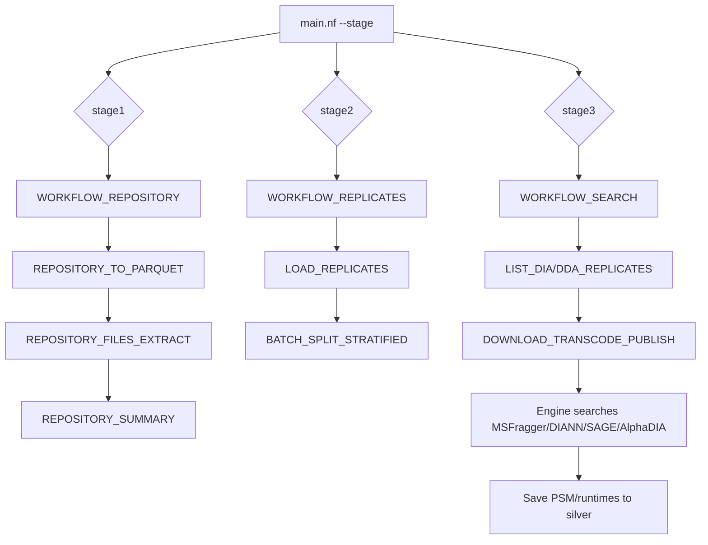

# nf_octaprot — Proteomics Repository Aggregation and Analysis Pipeline

nf_octaprot is a Nextflow DSL2 pipeline for discovering proteomics datasets from public FTP repositories (PRIDE, jPOST), building file inventories, preparing annotated replicate batches, downloading/transcoding raw data to mzML.gz, running peptide search with multiple engines, and producing silver/gold Parquet outputs.

## Overview

### Purpose (verified from code)
- **Stage 1 (Repository scraping)**: Read repository lists from CSV, validate schema, connect via FTP to inventory files, generate per-repository Parquet files and a manual-annotation CSV summary.
- **Stage 2 (Replicate/batch preparation)**: Load annotated replicate CSVs, validate schema, join with discovered file sizes from silver, stratify and split into size-balanced batches.
- **Stage 3 (Search/processing)**: List DIA/DDA replicates from silver, download/transcode raw files to `output/bronze/*.mzML.gz` (via transcode container using Wine + msconvert), run peptide searches with MSFragger/DIANN/SAGE/AlphaDIA (selected engines depending on workflow), save PSMs and runtimes to silver, generate gold summaries/plots in parts of the full workflow.

The `main.nf` routes by `--stage`:
- `stage1` → `WORKFLOW_REPOSITORY` (workflows/01repository.nf)
- `stage2` → `WORKFLOW_REPLICATES` (workflows/02replicate.nf)  
- `stage3` → `WORKFLOW_SEARCH` (workflows/03search.nf)

Stages 4 (ingest bronze) and 99 (dump) exist as workflows/processes but are **commented/disabled** in `main.nf` in the current configuration. They can be run separately if needed (see [docs/EXECUTION.md](docs/EXECUTION.md)).

### Technologies and roles
- **Nextflow (DSL2)**: Orchestrator. Default executor in `nextflow.config` is **Kubernetes (`k8s`)** with namespace `nextflow`; a hostPath mount to `/home` is configured. See [docs/SETUP.md](docs/SETUP.md).
- **Docker/containers**: Each process uses a container image (many under `dev.ilab.usm.cl/dia/*`; Dockerfiles in `lib/` to build them). See [docs/SETUP.md](docs/SETUP.md#container-images).
- **Python with uv**: All pipeline scripts in `bin/*.py` use `#!/usr/bin/env -S uv run --with ...` shebangs (polars, ftputil, pymzml, pyarrow, matplotlib, numpy). Dependencies resolved on first run by `uv`.
- **Kubernetes/K3s**: Target execution backend; K3s is suitable for single-node local testing. Verify RBAC/namespace/storage as documented.
- **Parquet**: Silver/gold outputs are Parquet (schemas in `lib/silver_model.py`). Queryable with DuckDB (see [docs/OUTPUT.md](docs/OUTPUT.md)).

### Data flow (verified)
1. **Input CSVs** in `input/stage01_scrap/`, `input/stage02_batch/`, `input/stage03_dataset/`, `input/stage99_dumpdb/` (structure only; see [docs/EXECUTION.md](docs/EXECUTION.md#input-data-preparation)).
2. **Stage 1**: `REPOSITORY_TO_PARQUET` → `output/silver/repositories/*.parquet` (schema: `id,url,doi`); `REPOSITORY_FILES_EXTRACT` (via `012_repository_scrap.py`, FTP scan) → `output/silver/files/*.parquet` (schema: `replicate_id,repository_id,remote_path,size_bytes,scan_timestamp`); `REPOSITORY_SUMMARY` → `output/dump/01repo/*_samples_*.csv`, `*_other_*.csv` (samples need manual annotation).
3. **Stage 2**: `LOAD_REPLICATES` → `output/silver/replicates/*.parquet` (schema: `replicate_id,organism,source_type,material,condition,sample_group`); `BATCH_SPLIT_STRATIFIED` joins with `output/silver/files/*.parquet` on `replicate_id` and writes stratified CSV batches to `output/dump/02batch/` (target ~10GB/split).
4. **Stage 3**: `LIST_DIA_REPLICATES`/`LIST_DDA_REPLICATES` read `output/silver/replicates/*.parquet` and select files; `DOWNLOAD_TRANSCODE_PUBLISH` downloads raw files (using `silver/files` + repo URLs) and transcodes to `output/bronze/*.mzML.gz` (Wine + msconvert in transcode container); search engines produce results saved as PSM Parquet to `output/silver/psm/<engine>/` and runtimes to `output/silver/psm_runtime/<engine>/`.

**Workflow diagram (from code structure):**

## Prerequisites
See [docs/SETUP.md](docs/SETUP.md) for full details. Minimum verified requirements:
- **Java**: Required by Nextflow. Check with `java -version`.
- **Nextflow**: `>= 24.04.0` per `manifest.nextflowVersion`.
- **Docker**: For building/running containers locally; K3s uses containerd (images must be available to K3s).
- **K3s** + **kubectl**: For Kubernetes executor (default). Single-node supported.
- **uv** + **Python 3.12**: All `bin/*.py` scripts use `uv run` with `python3.12` in some shebangs; `uv` handles deps.
- **Network access**: To public FTPs (PRIDE/jPOST) for stages 1 and 3 downloads.

## Quick Start
1. **Check prerequisites**: `./setup.sh`
2. **Prepare K3s environment**: Configure namespace/permissions and ensure cluster Ready (see [docs/SETUP.md](docs/SETUP.md#k3s-setup)).
3. **Build required container images**: Build images referenced by processes (see [docs/SETUP.md](docs/SETUP.md#container-images)).
4. **Prepare input data**: Put CSVs in appropriate `input/stage*/` dirs (examples from `assets/*.zip`).
5. **Execute workflow**: `nextflow run main.nf --stage stage1` (or stage2/stage3). Commands run on host; processes run in Kubernetes pods per config.
6. **Inspect results**: Check `output/silver/`, `output/bronze/`, `output/dump/`, and Nextflow reports (`report.html`, `timeline.html`).

Detailed steps in [docs/EXECUTION.md](docs/EXECUTION.md).

## Repository Structure
Key directories/files (verified):
- `main.nf`, `nextflow.config`, `nextflow-not.config` (local executor variant), `conf/profiles.config`, `conf/resources.config`
- `workflows/` - stage workflows; `modules/` - process definitions
- `bin/*.py` - all pipeline scripts (uv-based)
- `lib/` - Dockerfiles (`lib/Dockerfile_*`), schemas (`silver_model.py`, SQL generators)
- `input/`, `output/` - input/output dirs with `.gitignore` placeholders
- `assets/` - sample input zips
- `docs/` - documentation

## Execution and Output
- **Launch**: Use `main.nf` with `--stage stage1|stage2|stage3`. Default executor is K8s.
- **Logs/results**: Nextflow writes to `work/` and produces `report.html`, `timeline.html` (enabled in config). Published outputs go to `output/silver/`, `output/bronze/`, `output/dump/`, `output/gold/` per process `publishDir/storeDir` settings.
- **Details**: [docs/EXECUTION.md](docs/EXECUTION.md), [docs/OUTPUT.md](docs/OUTPUT.md)
